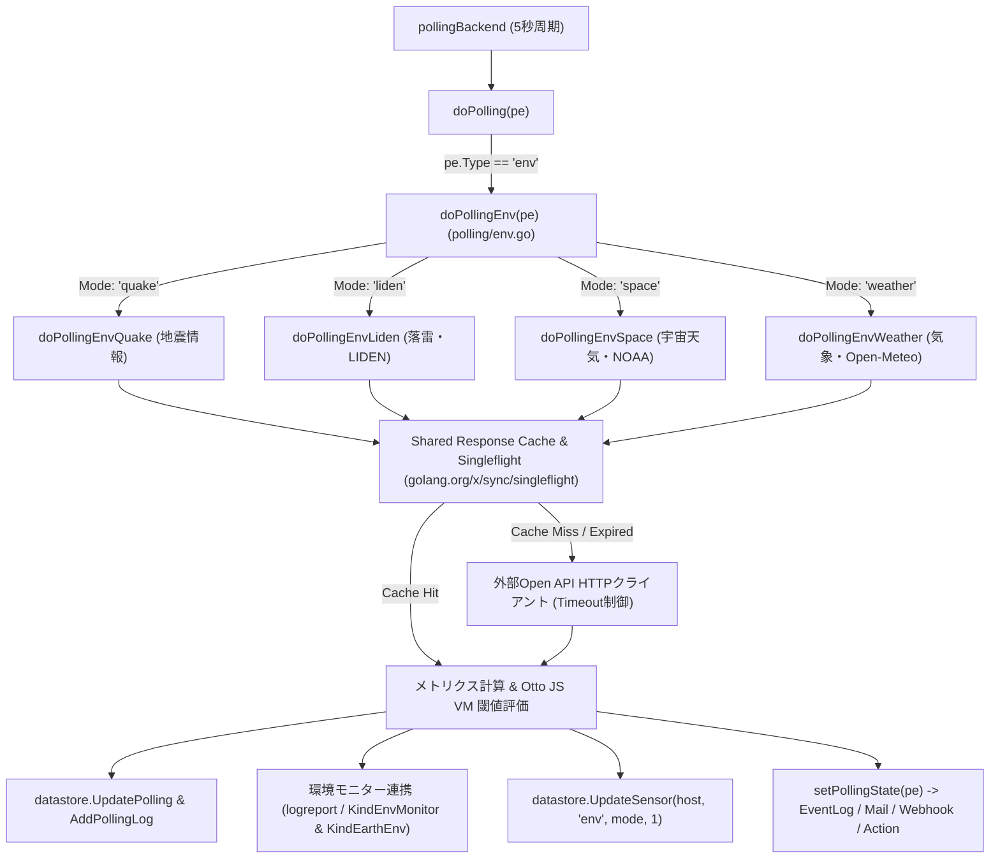

# 地球環境・防災・宇宙天気オープンAPI統合 実装仕様書 (`ENV_API_POLLING_SPEC.md`)

## 0. 前提調査・既存コードベースとの整合性確認結果

本仕様書の策定にあたり、現行リポジトリ（`twsnmpfk`）のアーキテクチャおよび実装パターンを調査し、以下の設計整合性を確認しました。

| コンポーネント | 既存コードの調査結果と設計パターン | 本仕様での統合方針 |
| :--- | :--- | :--- |
| **ポーリングエンジン** | [`polling/polling.go`](file:///Users/ymi/prj/twsnmp/twsnmpfk/polling/polling.go) にて5秒周期のスケジューラ（`checkPolling`）と最大300並列のワーカーチャネル（`doPollingCh`）で駆動。各ポーリング種別は `switch pe.Type` で分岐し、[`otto`](https://github.com/robertkrimen/otto) JavaScript VM（`setVMFuncAndValues`）により `pe.Script` で閾値判定および `setLevel()` による動的レベル変更が可能。 | 新規ポーリング種別 `Type: "env"`（地球環境・防災・宇宙天気）を追加し、`Mode` でデータソース（`quake`, `liden`, `space`, `weather`）を切り替える。既存の [`polling/otel.go`](file:///Users/ymi/prj/twsnmp/twsnmpfk/polling/otel.go) と同じ `key=value` パラメータ解析パターンを踏襲する。 |
| **データストア・永続化** | [`datastore/polling.go`](file:///Users/ymi/prj/twsnmp/twsnmpfk/datastore/polling.go), [`datastore/node.go`](file:///Users/ymi/prj/twsnmp/twsnmpfk/datastore/node.go) にて `bbolt`（`twsnmpfk.db`）上の JSON シリアライズで管理。ポーリングログは `MapConf.LogFormat` に応じて `bbolt` または `Parquet`（[`datastore/parquet.go`](file:///Users/ymi/prj/twsnmp/twsnmpfk/datastore/parquet.go)）に保存。ノードは既に `NodeEnt.Loc`（`"経度,緯度"` 形式: [`frontend/src/lib/Location.svelte`](file:///Users/ymi/prj/twsnmp/twsnmpfk/frontend/src/lib/Location.svelte)）を保持している。 | **DBスキーマ変更なし（完全後方互換）**。`NodeEnt.Loc`（`lng,lat`）および `MapConf` の地図中心（`LocConf.Center`）を座標のデフォルト値として活用しつつ、`PollingEnt.Params` で個別に `lat=...,lon=...,radius=...` 等を上書き指定可能にする。 |
| **環境モニター・レポート機能** | [`logreport/models.go`](file:///Users/ymi/prj/twsnmp/twsnmpfk/logreport/models.go) および [`frontend/src/lib/reports/EnvSensor.svelte`](file:///Users/ymi/prj/twsnmp/twsnmpfk/frontend/src/lib/reports/EnvSensor.svelte) が `bbolt` の `logReport` バケット配下（`envMonitor`, `powerMonitor`, `motionSensor`）を管理。また [`datastore/sensor.go`](file:///Users/ymi/prj/twsnmp/twsnmpfk/datastore/sensor.go) がセンサー稼働状態を管理。 | 1. 既存の `EnvDataEnt`（気温・湿度・気圧）へ Open-Meteo データをシームレスに連携可能にする。<br>2. 地震・落雷・宇宙天気・気象拡張指標（CAPE等）を保持するレポート種別 `KindEarthEnv = "earthEnv"` を `logreport` に追加し、[`EnvSensor.svelte`](file:///Users/ymi/prj/twsnmp/twsnmpfk/frontend/src/lib/reports/EnvSensor.svelte) のサブタブおよびマップ表示・描画アイテム（[`DrawItem.svelte`](file:///Users/ymi/prj/twsnmp/twsnmpfk/frontend/src/lib/DrawItem.svelte)）と連携する。 |
| **アラート・AI・外部連携** | [`polling/polling.go`](file:///Users/ymi/prj/twsnmp/twsnmpfk/polling/polling.go) の `setPollingState` → `datastore.AddEventLog` → `doAction`（`mail`, `webhook`, `mqtt`, `cmd`, `wol`）および [`notify/notify.go`](file:///Users/ymi/prj/twsnmp/twsnmpfk/notify/notify.go) の定期通知・根本原因分析（Dependency Analysis）。AI異常検知（[`backend/ai.go`](file:///Users/ymi/prj/twsnmp/twsnmpfk/backend/ai.go)）は `pe.Result` 内の `float64` キーを自動抽出。 | `pe.Result` にすべての監視メトリクスを `float64` 型で格納することで、既存のAI異常検知（Isolation Forest / Mahalanobis等）、ポーリング時系列グラフ（[`PollingReport.svelte`](file:///Users/ymi/prj/twsnmp/twsnmpfk/frontend/src/lib/PollingReport.svelte)）、MQTTパブリッシュ、LLMレポート解説（[`app_llm.go`](file:///Users/ymi/prj/twsnmp/twsnmpfk/app_llm.go)）がそのまま動作する設計とする。 |
| **プロジェクト固有ルール** | [`.agents/AGENTS.md`](file:///Users/ymi/prj/twsnmp/twsnmpfk/.agents/AGENTS.md):<br>1. `window.confirm()` の使用禁止（Flowbite Modal またはインライン確認を使用）<br>2. `<TabItem>` やスロット内の DataTables `<table>` は必ず `<div>` でラップする | フロントエンドUI（[`EnvSensor.svelte`](file:///Users/ymi/prj/twsnmp/twsnmpfk/frontend/src/lib/reports/EnvSensor.svelte) 等の拡張時）において上記2原則を厳守する。 |

---

## 1. アーキテクチャ統合方針

### 1.1 ポーリングエンジンへの組み込み方式：専用種別 `Type: "env"` の新設

既存の汎用 `http` ポーリング（`jsonpath` 抽出）を拡張する方式と比較検討した結果、以下の理由により**新規ポーリング種別 `Type: "env"`（ファイル: `polling/env.go`）を新設する方式**を採用します。

1. **多段階リクエストと空間演算の必要性**
   - 気象庁 LIDEN（落雷）は「① `targetTimes_N3.json` から最新の `basetime` / `validtime` を取得 → ② GeoJSON を取得 → ③ 監視対象ノードの緯度経度と全落雷座標との **Haversine（球面三角法）距離計算**を行い指定半径以内の落雷数・最接近距離を算出」という2段階通信＋地理空間計算が必要であり、単一URLの `jsonpath` では表現できない。
   - 地震情報においても、震源座標とノード座標からの距離計算や、指定都道府県・地域コードでのフィルタリング、発生時刻の鮮度判定（過去の古い地震でアラートを出し続けない制御）が必要。
   - 太陽フレア（NOAA GOES X線フラックス）は波長チャネル（`0.1-0.8nm` 長波長側）のフィルタリングと、物理量（$\text{W/m}^2$）からフレア等級（A/B/C/M/Xクラス数値スコア）への対数変換が必要。
   - Open-Meteo は現在値だけでなく「3時間前との気圧変化量（$\Delta\text{hPa}$）」の算出が必要。
2. **設定UIのユーザビリティとテンプレート提供**
   - `Type: "env"` とし、`Mode` に `"quake"`, `"liden"`, `"space"`, `"weather"` を定義することで、[`frontend/src/lib/pollingModes.ts`](file:///Users/ymi/prj/twsnmp/twsnmpfk/frontend/src/lib/pollingModes.ts) のガイド機能（プレースホルダー・利用可能変数一覧・スクリプト例）がそのまま機能する。

#### ポーリングディスパッチ構造



---

### 1.2 レスポンスキャッシュ機構・レートリミット保護・非ブロッキング設計

同一拠点（または全国）の複数ノードに環境ポーリングを設定した場合や、ユーザーが誤って `PollInt: 5`（5秒間隔）のような短いポーリング間隔を設定した場合でも、外部オープンAPIへの過剰リクエスト（DoS状態やIPバン）を防ぎ、かつTWSNMP本体の監視ループを絶対にブロックしないため、以下の3層保護機構を `polling/env_cache.go` に実装します。

#### ① `singleflight` による同時リクエスト統合（Thundering Herd 防止）
- `go.mod` に既に含まれている `golang.org/x/sync/singleflight` を使用。
- 複数ノードのポーリングゴルーチンが同時に同一キャッシュキー（同一URLまたは同一緯度経度グリッド）のデータ取得を要求した場合、**実際に外部APIへHTTPリクエストを発行するのは先着の1ゴルーチンのみ**とし、他のゴルーチンはその完了を待って同一レスポンスを共有します。

#### ② データソース別 TTL 付きインメモリ共有キャッシュ（最小ポーリング間隔の強制）
ポーリング設定側の `pe.PollInt` がどれだけ短くても、キャッシュの `MinTTL` が経過するまではキャッシュされた構造化データを返却します。

| データソース (`Mode`) | キャッシュキー生成ルール | 強制最小TTL (`MinTTL`) | 推奨ポーリング間隔 (`PollInt`) | 理由 |
| :--- | :--- | :--- | :--- | :--- |
| **地震 (`quake`)** | `"quake:p2p"` または `"quake:jma"`（全ノードで単一キャッシュ共有） | **60秒** | 60〜300秒 | 全国履歴リスト1回の取得で全ノード分の震度・震源距離を計算可能なため。 |
| **落雷 (`liden`)** | `"liden:latest"`（全国GeoJSONを単一キャッシュ共有） | **60秒** | 60〜300秒 | 気象庁ナウキャストLIDENは5分更新、1ファイルで全国データを保持するため全ノードで共有可能。 |
| **宇宙天気 (`space`)** | `"space:goes_xray"`, `"space:kp_index"`（全ノードで単一キャッシュ共有） | **180秒 (3分)** | 300〜600秒 | NOAA SWPC JSONは1分〜5分更新の地球規模データであり、拠点によらず全ノード共通のため。 |
| **気象 (`weather`)** | `fmt.Sprintf("weather:%.2f,%.2f", roundLat, roundLon)`<br>※緯度・経度を**小数点以下2桁（約1.1kmメッシュ）に丸めてキー化** | **300秒 (5分)** | 600〜1800秒 | Open-Meteo は15分〜1時間更新。同一ビル・同一敷地内の複数ノードの微妙な座標差を丸めてキャッシュヒット率を高める。 |

#### ③ Stale-if-Error（外部API障害・タイムアウト時の監視ループ保護）
- **専用HTTPクライアントとタイムアウト上限**:
  - `pe.Timeout` が未設定または過大な場合でも、外部API呼び出しのコンテキストタイムアウトは `clamp(pe.Timeout, 3, 15)` 秒（デフォルト10秒）に制限する。
  - レスポンスボディ読み取りは `io.LimitReader(resp.Body, 10*1024*1024)`（最大10MB）で制限し、メモリ肥大化を防止する。
  - `User-Agent: TWSNMP-FK/1.0 (+https://github.com/twsnmp/twsnmpfk)` を明示設定する（JMA / NOAA / Open-Meteo 等のオープンAPI利用マナー準拠）。
- **一時的エラー時のフォールバックとサーキットブレーカー**:
  - 外部APIが `5xx` エラーやネットワークタイムアウトを返した場合、キャッシュ内に `MaxStale`（`MinTTL * 3`、最大30分）以内の前回成功データがあればそれを返しつつ `pe.Result["cached"] = 1.0` を付与し、不要な誤報（フラッピング）を抑止する。
  - 失敗時は `BackoffUntil = now + 30秒` を記録し、バックオフ期間中の後続ポーリングは即座にエラー返却してゴルーチン滞留を防ぐ。

---

## 2. データモデル・設定パラメータ定義

### 2.1 位置情報（緯度・経度）の解決優先順位（フォールバック設計）

環境ポーリング（`quake`, `liden`, `weather`）で必要となる監視対象座標（`lat`, `lon`）は、以下の優先順位で自動解決します。

1. **ポーリング設定 `pe.Params` 内の明示指定**: `lat=35.6895,lon=139.6917`
2. **対象ノードの位置情報 `NodeEnt.Loc`**:
   - ※**重要（既存仕様との整合性）**: [`frontend/src/lib/Location.svelte`](file:///Users/ymi/prj/twsnmp/twsnmpfk/frontend/src/lib/Location.svelte#L88-L94) において、`NodeEnt.Loc` および `LocConf.Center` は **`"経度(lng),緯度(lat)"`**（例: `"139.75,35.68"`）の順序で保存されている。
   - したがって、`NodeEnt.Loc` から自動取得するヘルパー関数 `resolveNodeLatLon(pe)` は、カンマ区切りの第1要素を `lon`（経度）、第2要素を `lat`（緯度）としてパースする（値域チェック: `|lat| <= 90`, `|lon| <= 180` により逆順入力も安全に補正可能とする）。
3. **ノードのIPアドレスからの GeoIP 解決**: `datastore.GetLoc(n.IP)` から緯度・経度が取得できた場合（グローバルIPノードの場合）。
4. **マップ全体設定 `datastore.LocConf.Center`**: デフォルト `"139.75,35.68"`（東京）。

この階層化により、**すでに「ロケーション（地図）」画面でノードを地図上に配置しているユーザーは、`Params` を空欄にするだけでそのノードの設置地点の落雷・気象・震源距離を自動監視**できます。

---

### 2.2 各モードのパラメータ・取得メトリクス・判定ロジック詳細

`pe.Params` は既存の [`polling/otel.go`](file:///Users/ymi/prj/twsnmp/twsnmpfk/polling/otel.go#L26-L50) と同様、`key=value` のカンマ区切り形式（例: `lat=35.68,lon=139.75,radius=20`）で指定します。

---

#### (1) 地震情報モード (`Type: "env"`, `Mode: "quake"`)

- **対象API**:
  - `source=auto`（デフォルト）: 監視座標が日本域内（緯度 `20〜46°`, 経度 `122〜154°`）なら `p2p`、**日本域外（海外）なら自動的に `usgs`** を選択。
  - `source=p2p`: P2P地震情報 API v2 `https://api.p2pquake.net/v2/history?codes=551&limit=10`（日本国内向け）
  - `source=jma`: 気象庁防災情報 JSON `https://www.jma.go.jp/bosai/quake/data/list.json`（日本国内向け）
  - `source=usgs`: **USGS Earthquake Hazards Program GeoJSON Feed** `https://earthquake.usgs.gov/earthquakes/feed/v1.0/summary/all_hour.geojson`（**全世界対応**・毎分更新・登録/APIキー不要）
- **設定パラメータ (`pe.Params`)**:
  - `source`: `"auto"`（デフォルト）, `"p2p"`, `"jma"`, `"usgs"`
  - `radius`: USGSモード時の監視半径 km（デフォルト: `300.0` km）
  - `pref`: 都道府県名（例: `東京都`, `神奈川県`）※P2P地震情報の `points[].pref` マッチ用
  - `area`: 地域名または地域コードの部分一致フィルタ（例: `東京２３区`, `350`）
  - `lat`, `lon`: 監視地点の緯度・経度（未指定時は `Node.Loc` → `LocConf.Center`）
  - `max_age`: 有効とする地震発生からの最大経過秒数（デフォルト: `3600` 秒 = 1時間以内の地震のみを状態判定対象とし、それ以前の地震は震度メトリクスを `0` にリセットして自動復旧させる）
- **気象庁震度スケール / USGS MMI から数値 (`intensity`) への正規化マッピング**:
  スクリプトで直感的に大小比較（`intensity >= 3.0` や `intensity >= 5.0`）できるよう、以下の数値に変換します（USGSの改正メルカリ震度 `mmi` 1〜10もJMA震度相当に概算マッピングし、生の `mmi` と `tsunami` フラグも併せて保存します）。

  | 気象庁震度階級 | P2P API `scale` 値 | JMA `maxi` 値 | USGS `mmi` 概算 | `pe.Result["intensity"]` (`float64`) | 推奨判定レベル |
  | :--- | :---: | :---: | :---: | :---: | :--- |
  | 震度0 / 対象外 | -1 / 0 | - | `< 1.5` | `0.0` | `normal` |
  | 震度1 | 10 | `"1"` | `1.5 - 2.4` | `1.0` | `normal` |
  | 震度2 | 20 | `"2"` | `2.5 - 3.4` | `2.0` | `normal` |
  | 震度3 | 30 | `"3"` | `3.5 - 4.4` | `3.0` | `info` / `warn` |
  | 震度4 | 40 | `"4"` | `4.5 - 5.4` | `4.0` | `warn` |
  | 震度5弱 | 45 | `"5-"` | `5.5 - 6.4` | `5.0` | `low` / `high` |
  | 震度5強 | 50 | `"5+"` | `6.5 - 7.4` | `5.5` | `high` |
  | 震度6弱 | 55 | `"6-"` | `7.5 - 8.4` | `6.0` | `high` |
  | 震度6強 | 60 | `"6+"` | `8.5 - 9.4` | `6.5` | `high` |
  | 震度7 | 70 | `"7"` | `>= 9.5` | `7.0` | `high` |

- **保存メトリクス (`pe.Result`)**:
  - `intensity` (`float64`): 有効時間内（`max_age` 以内）の指定地域（または距離・MMI換算）最大震度（`0.0`〜`7.0`）
  - `max_intensity` (`float64`): 当該地震の最大震度（`0.0`〜`7.0`）
  - `mmi` (`float64`): USGS 改正メルカリ震度（USGS時）
  - `tsunami` (`float64`): 津波警報フラグ `0` または `1`（USGS時）
  - `magnitude` (`float64`): マグニチュード（例: `5.4`、不明時は `0.0`）
  - `depth_km` (`float64`): 震源の深さ (km)
  - `distance_km` (`float64`): 監視ノードの緯度経度から震源までの直線距離 (km、Haversine公式で算出)
  - `elapsed_sec` (`float64`): 最新地震発生時刻からの経過秒数
  - `quake_time` (`string`): 最新地震の発生時刻（RFC3339形式）
  - `hypocenter` (`string`): 震央地名（例: `"千葉県北西部"` / `"10km SSE of San Jose, CA"`）
  - `source` (`string`): 実際に使用されたデータソース（`"p2p"`, `"jma"`, `"usgs"`）
  - `rtt` (`float64`): API応答時間 (ns)
- **判定スクリプト例 (`pe.Script`)**:
  ```javascript
  // 震度5弱以上で重度(high)、震度3以上で注意(warn)、または震源距離50km以内かつM5.0以上で注意
  if (intensity >= 5.0) {
    setLevel("high");
    false;
  } else if (intensity >= 3.0 || (distance_km <= 50 && magnitude >= 5.0)) {
    setLevel("warn");
    false;
  } else {
    true;
  }
  ```

---

#### (2) 落雷・雷活動情報モード (`Type: "env"`, `Mode: "liden"`)

- **対象API（日本国内＋海外ハイブリッド対応）**:
  - `source=auto`（デフォルト）: 監視座標が日本域内（緯度 `20〜46°`, 経度 `122〜154°`）なら気象庁 LIDEN GeoJSON、**日本域外（海外）なら Open-Meteo 雷雨・発雷リスク検知へ自動フォールバック**。
  - `source=jma`（日本国内向け）:
    1. 時刻インデックス取得: `https://www.jma.go.jp/bosai/jmatile/data/nowc/targetTimes_N3.json`（`elements` に `"liden"` を含む最新エントリの `basetime` / `validtime` を抽出）
    2. 観測GeoJSON取得: `https://www.jma.go.jp/bosai/jmatile/data/nowc/{basetime}/none/{validtime}/surf/liden/data.geojson?id=liden`
  - `source=openmeteo`（**全世界対応**・APIキー不要）:
    - Open-Meteo API の WMO天気コード（`95`: 雷雨、`96/99`: 雹を伴う激しい雷雨）および大気不安定度（`CAPE`）から雷雨・発雷リスクを判定し、既存の `strike_count` / `close_count` 指標へマッピング。
  - `geojson_url=...`: 上級者向けカスタム GeoJSON エンドポイント指定（自前の Blitzortung→GeoJSON プロキシ等）。
- **設定パラメータ (`pe.Params`)**:
  - `source`: `"auto"`（デフォルト）, `"jma"`, `"openmeteo"`
  - `lat`, `lon`: 監視対象ノードの緯度・経度（未指定時は `Node.Loc` → `LocConf.Center`）
  - `radius`: 監視半径 km（デフォルト: `20.0` km、JMA LIDEN / GeoJSON時）
  - `warn_radius`: 警戒半径 km（デフォルト: `10.0` km、JMA LIDEN / GeoJSON時）
- **保存メトリクス (`pe.Result`)**:
  - `strike_count` (`float64`): 指定半径（`radius` km）以内の総落雷・放電数（Open-Meteo時は雷雨/高CAPE検知時に `1` 以上）
  - `close_count` (`float64`): 警戒半径（`warn_radius` km）以内の至近落雷・放電数（Open-Meteo時は激しい雷雨 `weather_code >= 96` または `cape >= 2000` 時に `1`）
  - `cg_count` (`float64`): 指定半径以内の対地落雷（Cloud-to-Ground）数
  - `ic_count` (`float64`): 指定半径以内の雲間放電（Intra-Cloud）数
  - `nearest_km` (`float64`): 監視地点から最接近落雷までの距離 (km)。全国で落雷ゼロの場合は `9999.0`
  - `national_count` (`float64`): 全国総検知数（参考指標）
  - `source` (`string`): 実際に使用されたデータソース（`"jma"`, `"openmeteo"`, `"custom"`）
  - `obs_time` (`string`): 観測基準時刻（RFC3339形式）
  - `rtt` (`float64`): API応答時間 (ns)
- **デフォルト判定ロジック / スクリプト例 (`pe.Script`)**:
  ```javascript
  // 10km以内の落雷(close_count > 0)で重度(high)、20km以内の落雷(strike_count > 0)で注意(warn)
  if (close_count > 0 || nearest_km <= 10.0) {
    setLevel("high");
    false;
  } else if (strike_count > 0) {
    setLevel("warn");
    false;
  } else {
    true;
  }
  ```

---

#### (3) 宇宙天気・太陽フレア・地磁気嵐モード (`Type: "env"`, `Mode: "space"`)

- **対象API**:
  1. 太陽X線フラックス（GOES衛星 6時間データ）:
     `https://services.swpc.noaa.gov/json/goes/primary/xrays-6-hour.json`
     - `energy == "0.1-0.8nm"` の最新レコードの `flux` ($\text{W/m}^2$) を取得。
  2. 地磁気嵐指数（惑星Kp指数 1分値）:
     `https://services.swpc.noaa.gov/json/planetary_k_index_1m.json`
     - 配列末尾（最新）の `kp_index` または `estimated_kp` ($0.0 \sim 9.0$) を取得。
- **太陽フレア等級の数値化スコア (`flare_score`)**:
  X線フラックス $F$ ($\text{W/m}^2$) から連続値スコアを算出します：
  $$\text{flare\_score} = \max(0, \log_{10}(F) + 8.0)$$
  - Aクラス ($10^{-8} \le F < 10^{-7}$): `0.0` 〜 `0.99`
  - Bクラス ($10^{-7} \le F < 10^{-6}$): `1.0` 〜 `1.99`
  - Cクラス ($10^{-6} \le F < 10^{-5}$): `2.0` 〜 `2.99`
  - Mクラス ($10^{-5} \le F < 10^{-4}$): `3.0` 〜 `3.99`（中規模フレア：短波無線通信障害・デリンジャー現象警戒）
  - Xクラス ($F \ge 10^{-4}$): `4.0` 以上（大規模フレア：GPS同期異常・衛星通信障害・大規模磁気嵐リスク）
- **設定パラメータ (`pe.Params`)**:
  - 空欄可（地球規模データのためパラメータ不要。オプションで `target=xray`, `target=kp`, `target=all` を選択可能、デフォルト `all`）
- **保存メトリクス (`pe.Result`)**:
  - `xray_flux` (`float64`): GOES太陽X線フラックス ($\text{W/m}^2$, 例: `1.5e-5`)
  - `flare_score` (`float64`): フレア等級の対数スコア（A=`0.x`, B=`1.x`, C=`2.x`, M=`3.x`, X=`4.x+`）
  - `flare_class` (`string`): 人間可読なフレア等級文字列（例: `"M1.5"`, `"X2.1"`, `"C3.4"`）
  - `kp_index` (`float64`): 最新Kp指数（`0.0`〜`9.0`）
  - `g_scale` (`float64`): NOAA地磁気嵐スケール G0〜G5（Kp<5: `0`, Kp=5: `1` (G1), Kp=6: `2` (G2), Kp=7: `3` (G3), Kp=8: `4` (G4), Kp=9: `5` (G5)）
  - `rtt` (`float64`): API応答時間 (ns)
- **判定スクリプト例 (`pe.Script`)**:
  ```javascript
  // Xクラスフレア(flare_score >= 4.0) または 強い地磁気嵐(kp_index >= 7.0: G3以上) で重度(high)
  // Mクラスフレア(flare_score >= 3.0) または 軽度地磁気嵐(kp_index >= 5.0: G1以上) で注意(warn)
  if (flare_score >= 4.0 || kp_index >= 7.0) {
    setLevel("high");
    false;
  } else if (flare_score >= 3.0 || kp_index >= 5.0) {
    setLevel("warn");
    false;
  } else {
    true;
  }
  ```

---

#### (4) 気象・気圧・大気不安定度モード (`Type: "env"`, `Mode: "weather"`)

- **対象API**:
  - Open-Meteo Forecast API:
    `https://api.open-meteo.com/v1/forecast?latitude={lat}&longitude={lon}&current=temperature_2m,relative_humidity_2m,surface_pressure,pressure_msl,wind_speed_10m,wind_gusts_10m,precipitation,weather_code,cape&hourly=surface_pressure,cape&past_hours=6&forecast_hours=1&wind_speed_unit=ms`
- **設定パラメータ (`pe.Params`)**:
  - `lat`, `lon`: 監視対象ノードの緯度・経度（未指定時は `Node.Loc` → `LocConf.Center`）
  - `sync_env_report`: `"true"`（デフォルト）または `"false"`。`"true"` の場合、取得した気温・湿度・気圧を既存の環境センサーレポート（`KindEnvMonitor`）にも自動記録する。
- **保存メトリクス (`pe.Result`)**:
  - `temp` (`float64`): 気温 (℃) ※既存 [`frontend/src/lib/chart/polling.ts`](file:///Users/ymi/prj/twsnmp/twsnmpfk/frontend/src/lib/chart/polling.ts#L57-L60) の `chartParams["temp"]` とキー名を一致させ、単位ラベル自動適用
  - `humidity` (`float64`): 相対湿度 (%) ※既存 `chartParams["humidity"]` と一致
  - `pressure` (`float64`): 現地気圧 (hPa) ※既存 `chartParams["pressure"]` と一致
  - `pressure_msl` (`float64`): 海面更生気圧 (hPa)
  - `pressure_diff_3h` (`float64`): 3時間前からの気圧変化量 ($\text{hPa}$、急激な気圧低下時はマイナス値、例: `-6.5`)
  - `cape` (`float64`): 対流有効位置エネルギー ($\text{J/kg}$。`1000` 以上で雷雨・突風注意、`2500` 以上で激しい雷雨・竜巻リスク)
  - `wind` (`float64`): 風速 ($\text{m/s}$) ※既存 `chartParams["wind"]` と一致
  - `wind_gust` (`float64`): 最大瞬間風速 ($\text{m/s}$)
  - `precipitation` (`float64`): 降水量 ($\text{mm}$)
  - `weather_code` (`float64`): WMO天気コード（`95`, `96`, `99` は雷雨）
  - `rtt` (`float64`): API応答時間 (ns)
- **判定スクリプト例 (`pe.Script`)**:
  ```javascript
  // 猛烈な突風(wind_gust >= 25m/s)、激しい大気不安定(cape >= 2000)、急激な気圧低下(3時間で-6hPa以下)で警告
  if (wind_gust >= 25.0 || cape >= 2500 || pressure_diff_3h <= -10.0) {
    setLevel("high");
    false;
  } else if (wind_gust >= 15.0 || cape >= 1000 || pressure_diff_3h <= -5.0 || weather_code >= 95) {
    setLevel("warn");
    false;
  } else {
    true;
  }
  ```

---

## 3. 環境モニター画面・グラフ・マップ連携仕様

既存のUI資産を最大限に活かしつつ、以下の4箇所に環境・防災・宇宙天気メトリクスを統合します。

### 3.1 環境センサーレポート画面（`EnvSensor.svelte`）との統合

現在、[`frontend/src/lib/reports/EnvSensor.svelte`](file:///Users/ymi/prj/twsnmp/twsnmpfk/frontend/src/lib/reports/EnvSensor.svelte) は `env`（環境センサー: 気温・湿度・CO2/TVOC）、`power`（電力センサー）、`motion`（人感センサー）の3つのサブタブを持っています。

これを以下のように拡張します：

1. **既存 `envMonitor`（環境センサータブ）への気象・気圧データのマッピング**:
   - `Mode: "weather"` のポーリング実行時、既存の `logreport.EnvMonitorEnt` 構造体（`Address: "open-meteo:" + node.ID`, `Host: node.Name`, `Name: pe.Name`）に対して、`Temp`（気温）、`Humidity`（湿度）、`BarometricPressure`（現地気圧 hPa）を時系列追加（最大 `MaxSeriesSize = 2016` 点）します。
   - [`EnvSensor.svelte`](file:///Users/ymi/prj/twsnmp/twsnmpfk/frontend/src/lib/reports/EnvSensor.svelte#L79-L112) の `env` タブのテーブルカラムに **「気圧 (hPa)」** カラムを追加し、詳細モーダルの ECharts 時系列グラフでも気温・湿度とともに気圧推移を表示可能にします（既存の OMRON 気圧センサーのデータも同時に可視化されるようになります）。

2. **新規サブタブ `earth`（「防災・宇宙・気象API」タブ）の追加**:
   - [`logreport/models.go`](file:///Users/ymi/prj/twsnmp/twsnmpfk/logreport/models.go) に `KindEarthEnv = "earthEnv"` と以下のエンティティを追加します：
     ```go
     // EarthEnvDataEnt holds one time-series sample for open environmental/disaster API polling.
     type EarthEnvDataEnt struct {
         Time           int64   `json:"Time"`
         State          string  `json:"State"`
         // Weather (Open-Meteo)
         Temp           float64 `json:"Temp,omitempty"`
         Humidity       float64 `json:"Humidity,omitempty"`
         Pressure       float64 `json:"Pressure,omitempty"`
         PressureDiff3h float64 `json:"PressureDiff3h,omitempty"`
         CAPE           float64 `json:"CAPE,omitempty"`
         WindSpeed      float64 `json:"WindSpeed,omitempty"`
         WindGust       float64 `json:"WindGust,omitempty"`
         Precipitation  float64 `json:"Precipitation,omitempty"`
         // Quake (P2P / JMA)
         Intensity      float64 `json:"Intensity,omitempty"`
         Magnitude      float64 `json:"Magnitude,omitempty"`
         DistanceKm     float64 `json:"DistanceKm,omitempty"`
         Hypocenter     string  `json:"Hypocenter,omitempty"`
         // Liden (JMA Lightning)
         StrikeCount    int     `json:"StrikeCount,omitempty"`
         CloseCount     int     `json:"CloseCount,omitempty"`
         NearestKm      float64 `json:"NearestKm,omitempty"`
         // Space Weather (NOAA SWPC)
         XrayFlux       float64 `json:"XrayFlux,omitempty"`
         FlareScore     float64 `json:"FlareScore,omitempty"`
         FlareClass     string  `json:"FlareClass,omitempty"`
         KpIndex        float64 `json:"KpIndex,omitempty"`
     }

     type EarthEnvMonitorEnt struct {
         ID        string            `json:"ID"`        // PollingID or hash(NodeID+Mode)
         PollingID string            `json:"PollingID"`
         NodeID    string            `json:"NodeID"`
         Host      string            `json:"Host"`      // Node Name
         Mode      string            `json:"Mode"`      // "quake" | "liden" | "space" | "weather"
         Name      string            `json:"Name"`      // Polling Name
         Location  string            `json:"Location"`  // "lat,lon" or area name
         State     string            `json:"State"`
         Count     int               `json:"Count"`
         Data      []EarthEnvDataEnt `json:"Data"`
         FirstTime int64             `json:"FirstTime"`
         LastTime  int64             `json:"LastTime"`
     }
     ```
   - [`EnvSensor.svelte`](file:///Users/ymi/prj/twsnmp/twsnmpfk/frontend/src/lib/reports/EnvSensor.svelte) の上部 KPI カードおよびサブタブに **「地球環境・防災 (`earth`)」** タブを追加します。
   - 行をダブルクリックまたは「履歴グラフ」ボタンを押下すると、選択した `Mode` に応じた専用 ECharts マルチ軸チャートを表示します：
     - `weather`: 現地気圧 (hPa) ＆ 3時間気圧変化量 + CAPE ($\text{J/kg}$) 2軸グラフ
     - `liden`: 監視半径内落雷数（棒グラフ） ＆ 最接近距離 km（折れ線グラフ）
     - `space`: 太陽X線フラックス対数スコア（A/B/C/M/Xガイドライン付き） ＆ Kp指数（0〜9 カラーバンド付き）
     - `quake`: 最大震度推移 ＆ マグニチュード・震源距離

### 3.2 ポーリングレポート（`PollingReport.svelte` / `chart/polling.ts`）連携

- [`frontend/src/lib/chart/polling.ts`](file:///Users/ymi/prj/twsnmp/twsnmpfk/frontend/src/lib/chart/polling.ts#L24-L130) の `chartParams` に以下の軸定義を追加し、ポーリング結果ダイアログの時系列チャート・ヒストグラム・QQプロットで適切な単位ラベルが自動表示されるようにします：
  - `intensity`: `"震度 (JMA Scale)"`
  - `magnitude`: `"マグニチュード (M)"`
  - `distance_km`: `"震源距離 (km)"`
  - `strike_count`: `"落雷数 (回)"`
  - `nearest_km`: `"最接近落雷距離 (km)"`
  - `kp_index`: `"地磁気 Kp指数 (0-9)"`
  - `flare_score`: `"太陽フレア等級スコア"`
  - `cape`: `"CAPE (J/kg)"`
  - `pressure_diff_3h`: `"3時間気圧変化 (hPa)"`

### 3.3 マップ描画アイテム（`DrawItem.svelte`）でのダッシュボード可視化

- [`frontend/src/lib/DrawItem.svelte`](file:///Users/ymi/prj/twsnmp/twsnmpfk/frontend/src/lib/DrawItem.svelte#L54-L99) の `getRecommendation()` に上記変数名の推奨フォーマットを追加します：
  - `pressure`, `pressure_msl` → `{ format: "%.1f hPa", scale: 1.0, desc: "気圧 (hPa)" }`
  - `pressure_diff_3h` → `{ format: "%+.1f hPa/3h", scale: 1.0, desc: "3時間気圧変化" }`
  - `cape` → `{ format: "%.0f J/kg", scale: 1.0, desc: "大気不安定度 (CAPE)" }`
  - `kp_index` → `{ format: "Kp %.1f", scale: 1.0, desc: "地磁気嵐 Kp指数" }`
  - `strike_count`, `close_count` → `{ format: "%.0f strikes", scale: 1.0, desc: "落雷数" }`
  - `nearest_km`, `distance_km` → `{ format: "%.1f km", scale: 1.0, desc: "距離 (km)" }`
  - `intensity` → `{ format: "震度 %.1f", scale: 1.0, desc: "最大震度" }`
- これにより、ユーザーはメインのネットワークマップ上に**「現在のKp指数ゲージ」「拠点周辺の落雷数KPIカード」「現地気圧トレンドライン」**を配置してNOC（ネットワークオペレーションセンター）画面を構築できます。

### 3.4 センサー一覧（`SensorReport.svelte`）との連携

- 環境APIポーリングが成功するたびに `datastore.UpdateSensor(node.Name, "env-"+pe.Mode, pe.Name, 1)` を呼び出します。
- これにより、既存の「センサー」レポート画面（[`SensorReport.svelte`](file:///Users/ymi/prj/twsnmp/twsnmpfk/frontend/src/lib/reports/SensorReport.svelte)）において、`env-quake`, `env-liden`, `env-space`, `env-weather` のデータ取得稼働状況と途絶監視が一元管理されます。

---

## 4. イベント・アラート連携仕様

### 4.1 イベントログ出力フォーマット

閾値超過により `setPollingState(pe, newState)` が状態遷移を検知した際、既存のイベントログ機構（[`polling/polling.go`](file:///Users/ymi/prj/twsnmp/twsnmpfk/polling/polling.go#L396-L417)）を通じて `bbolt` の `logs` バケットへ記録されます。

さらに、地球環境・防災ポーリングでは**イベントログの文面（`EventLogEnt.Event`）だけで発生事象のサマリが即座に把握できるよう**、`pe.Result["_ summary"]`（内部補助キー）または専用サマリフォーマッタを用いて以下の詳細情報を付加します：

| モード | イベントログ出力フォーマット例 (`EventLogEnt.Event`) |
| :--- | :--- |
| **地震 (`quake`)** | `ポーリング状態変化:東京DC地震監視(env) [震央:千葉県北西部 M5.4 最大震度:4 (対象地域震度:4.0, 距離:32.5km)]` |
| **落雷 (`liden`)** | `ポーリング状態変化:大阪拠点落雷監視(env) [10km以内落雷:3回 (20km以内:14回, 最接近:4.2km)]` |
| **宇宙天気 (`space`)** | `ポーリング状態変化:宇宙天気監視(env) [太陽フレア:M2.4 (flux:2.40e-05 W/m2), 地磁気Kp指数:6.3 (G2)]` |
| **気象 (`weather`)** | `ポーリング状態変化:福岡拠点気象監視(env) [気圧:998.2hPa (3h変化:-6.4hPa), CAPE:1850J/kg, 最大瞬間風速:18.2m/s]` |

### 4.2 Webhook / メール / MQTT / Syslog 連携仕様

1. **ポーリングアクション Webhook (`doOneAction` -> `"webhook"`)**:
   - 既存の `webhookEnt` JSON ペイロード（`Time`, `Node`, `Polling`, `State`, `Results`）の `Results` マップ内に上記の全数値・文字列メトリクスが含まれて POST されます。
2. **定期通知 Webhook / メール (`notify/webhook.go`, `notify/email.go`)**:
   - `EventLogEnt` に記録された上記サマリ付きイベント文字列が通知メール本文および Webhook の `Log[].Event` にそのまま格納されます。
   - また、`NotifyConf.CheckDependency`（トポロジー依存関係分析）が有効な場合、拠点ルータの通信断と同時にその拠点ノードで地震や落雷アラートが発生していれば、同一拠点の事象として並べて通知されます。
3. **MQTT パブリッシュ連携 (`mqttPublishPollingResult`)**:
   - ポーリング設定に `MqttURL` と `MqttTopic` が設定されている場合、ポーリングごとに `pe.Result` のメトリクス JSON が MQTT ブローカーへ自動 Publish されます。

### 4.3 AI分析（異常検知）および LLM 診断連携

1. **AI異常検知（[`backend/ai.go`](file:///Users/ymi/prj/twsnmp/twsnmpfk/backend/ai.go)）**:
   - `pe.LogMode = datastore.LogModeAI`（AIモード）に設定すると、`getAIDataKeys(p)` が `pe.Result` 内のすべての `float64` 値を特徴量ベクトルとして自動抽出します。
   - 特に `Mode: "weather"`（気温・湿度・気圧・風速・CAPEの多変量相関による局所異常気象検知）や `Mode: "space"`（X線フラックスとKp指数の複合異常検知）において、既存の Isolation Forest / Mahalanobis / AutoEncoder がコード変更なしでそのまま機能します。
   - 特定の変数のみをAI学習対象にしたい場合は、既存の `pe.VectorCols` に `pressure,pressure_diff_3h,cape` のように指定可能です。
2. **LLM ノード診断・ポーリング解説（[`app_llm.go`](file:///Users/ymi/prj/twsnmp/twsnmpfk/app_llm.go)）**:
   - [`app_llm.go`](file:///Users/ymi/prj/twsnmp/twsnmpfk/app_llm.go#L93-L117) の `formatPollingResultForLLM()` に環境メトリクスの単位フォーマット（`pressure`: `hPa`, `distance_km` / `nearest_km`: `km`, `cape`: `J/kg`, `xray_flux`: `W/m²`）を追加します。
   - これにより、通信障害発生時に「AI診断」を実行すると、LLMが「同時刻に拠点から4.2km地点への落雷（`close_count: 3`）や震度4の地震が記録されており、電源サージまたは物理回線障害の可能性が高い」といった相関診断を自動生成できるようになります。

---

## 5. ポーリングテンプレート & AIポーリングアシスト対応仕様

ユーザーが複雑なAPIのURLやJavaScript判定式を一から記述しなくても、数クリック（または自然言語指示）で地球環境・防災・宇宙天気ポーリングを追加できるよう、既存の**ポーリングテンプレート機構**および**AIポーリングアシスト機構**を以下のように拡張します。

---

### 5.1 組み込みポーリングテンプレート定義 (`datastore/conf/polling_ja.json`, `polling_en.json`)

[`datastore/datastore.go`](file:///Users/ymi/prj/twsnmp/twsnmpfk/datastore/datastore.go#L166-L183) にて起動時に読み込まれる内蔵テンプレートファイル（日本語版 `polling_ja.json` / 英語版 `polling_en.json`）の末尾に、以下の**6種類の標準テンプレート**を追加します。

#### 日本語版 (`datastore/conf/polling_ja.json`) 追加エントリ
```json
  {
    "Name": "地震情報監視 (P2P地震情報)",
    "Type": "env",
    "Mode": "quake",
    "Params": "source=p2p,max_age=3600",
    "Script": "if (intensity >= 5.0) { setLevel('high'); false; } else if (intensity >= 3.0 || (distance_km <= 50 && magnitude >= 5.0)) { setLevel('warn'); false; } else { true; }",
    "Level": "high",
    "AutoParam": "loc",
    "Descr": "ノード設置地点(または指定地域)の地震震度と震源距離を監視。震度3以上で注意(warn)、震度5弱以上で重度(high)"
  },
  {
    "Name": "落雷・サージリスク監視 (気象庁LIDEN)",
    "Type": "env",
    "Mode": "liden",
    "Params": "radius=20,warn_radius=10",
    "Script": "if (close_count > 0 || nearest_km <= 10.0) { setLevel('high'); false; } else if (strike_count > 0) { setLevel('warn'); false; } else { true; }",
    "Level": "high",
    "AutoParam": "loc",
    "Descr": "気象庁LIDENデータより拠点周辺の落雷数・最接近距離を監視。半径20km以内落雷で注意(warn)、10km以内で重度(high)"
  },
  {
    "Name": "宇宙天気・太陽フレア・地磁気嵐監視 (NOAA)",
    "Type": "env",
    "Mode": "space",
    "Params": "",
    "Script": "if (flare_score >= 4.0 || kp_index >= 7.0) { setLevel('high'); false; } else if (flare_score >= 3.0 || kp_index >= 5.0) { setLevel('warn'); false; } else { true; }",
    "Level": "warn",
    "Descr": "NOAA GOES太陽X線フラックスとKp指数を監視。MクラスフレアまたはKp5(G1)以上で注意、XクラスまたはKp7(G3)以上で重度"
  },
  {
    "Name": "気象・急激な気圧変化・雷雨リスク監視 (Open-Meteo)",
    "Type": "env",
    "Mode": "weather",
    "Params": "",
    "Script": "if (wind_gust >= 25.0 || cape >= 2500 || pressure_diff_3h <= -10.0) { setLevel('high'); false; } else if (wind_gust >= 15.0 || cape >= 1000 || pressure_diff_3h <= -5.0 || weather_code >= 95) { setLevel('warn'); false; } else { true; }",
    "Level": "warn",
    "AutoParam": "loc",
    "Descr": "Open-Meteoより現地気圧・3時間気圧変化・大気不安定度(CAPE)・突風を監視し、環境センサーレポートにも記録"
  },
  {
    "Name": "拠点外気温・高温多湿監視 (Open-Meteo)",
    "Type": "env",
    "Mode": "weather",
    "Params": "",
    "Script": "if (temp >= 38.0) { setLevel('high'); false; } else if (temp >= 35.0 || temp <= -5.0) { setLevel('warn'); false; } else { true; }",
    "Level": "warn",
    "AutoParam": "loc",
    "Descr": "Open-Meteoより拠点の気温・湿度・気圧を定期記録し、猛暑(35℃/38℃以上)や氷点下の空調負荷リスクを監視"
  },
  {
    "Name": "GPS・無線通信障害予兆監視 (太陽フレア・Kp指数)",
    "Type": "env",
    "Mode": "space",
    "Params": "",
    "Script": "flare_score < 3.5 && kp_index < 6.0",
    "Level": "warn",
    "Descr": "NTP/PTPのGPS時刻同期劣化や短波・衛星通信障害(デリンジャー現象)を引き起こすM5クラス以上の太陽フレア・磁気嵐を検知"
  }
```

#### 英語版 (`datastore/conf/polling_en.json`) 追加エントリ
- 上記6件に対応する英語テンプレート（`"Earthquake Monitor (JMA / P2PQuake)"`, `"Lightning Surge Risk Monitor (JMA LIDEN)"`, `"Space Weather: Solar Flare & Geomagnetic Storm (NOAA)"`, `"Severe Weather, Pressure Drop & CAPE Monitor (Open-Meteo)"`, `"Ambient Temperature & Humidity Monitor (Open-Meteo)"`, `"GPS / Radio Blackout Precursor Monitor (NOAA SWPC)"`）を `polling_en.json` に追加します。

---

### 5.2 `AutoParam: "loc"` によるノード位置情報の自動展開 (`polling/polling.go`, `app_polling.go`)

既存のテンプレート機構では、[`polling/polling.go`](file:///Users/ymi/prj/twsnmp/twsnmpfk/polling/polling.go#L69-L80) の `GetAutoPollings(n *datastore.NodeEnt, pt *datastore.PollingTemplateEnt)` が `pt.AutoParam`（例: `"ifIndex"`, `"hrStorageSize"`）を解釈し、ノード固有のパラメータを自動設定した `PollingEnt` を生成しています。

これを拡張し、`pt.Type == "env"` かつ `pt.AutoParam == "loc"` の場合に**対象ノードの座標を自動補完する機能**を実装します：

1. **座標の自動解決と `Params` への展開**:
   - ユーザーがノードを選択してテンプレート（`AutoParam: "loc"`）を適用した際、`getAutoEnvPollings(n, pt)` を呼び出す。
   - `n.Loc`（`"経度,緯度"` 形式）が設定されている場合はそこから `lat=...,lon=...` を抽出し、未設定の場合は `datastore.GetLoc(n.IP)`（GeoIP）または `datastore.LocConf.Center`（マップ中心座標）から初期座標を取得して `p.Params` に自動挿入する（例: `"lat=35.6800,lon=139.7500,radius=20,warn_radius=10"`）。
   - これにより、編集ダイアログ（[`Polling.svelte`](file:///Users/ymi/prj/twsnmp/twsnmpfk/frontend/src/lib/Polling.svelte)）が開いた時点で**自分の拠点の緯度・経度が `Params` 欄にプレフィル（入力済み）された状態**になり、ユーザーは必要に応じて微調整するだけで保存できます。
2. **推奨ポーリング間隔 (`PollInt`) とログモード (`LogMode`) の最適初期値設定**:
   - [`app_polling.go`](file:///Users/ymi/prj/twsnmp/twsnmpfk/app_polling.go#L176-L206) の `GetAutoPollings` では通常 `p.PollInt = datastore.MapConf.PollInt`（60秒）、`p.LogMode = 0`（記録しない）がセットされます。
   - `pt.Type == "env"` のテンプレートから生成する場合は、外部APIの更新周期に合わせ、かつ時系列グラフがすぐに描画されるよう、以下の最適初期値を自動設定します：
     - `LogMode`: `datastore.LogModeAlways` (`1` = 常時記録。時系列チャート・環境モニター連携のためデフォルトON)
     - `PollInt`:
       - `Mode == "quake"` / `"liden"`: `120` 秒（2分）
       - `Mode == "space"`: `300` 秒（5分）
       - `Mode == "weather"`: `600` 秒（10分）
     - `Timeout`: `10` 秒

---

### 5.3 AIポーリングアシスト (`app_llm.go`, `AIPollingAssistDialog.svelte`) への組み込み

[`frontend/src/lib/AddPolling.svelte`](file:///Users/ymi/prj/twsnmp/twsnmpfk/frontend/src/lib/AddPolling.svelte#L173-L178) の「AIアシスト」ボタンから呼び出される `LLMAssistPolling`（[`app_llm.go`](file:///Users/ymi/prj/twsnmp/twsnmpfk/app_llm.go#L660-L796)）にも対応させます。

1. **LLMシステムプロンプト (`app_llm.go`) の拡張**:
   - `LLMAssistPolling` のシステムプロンプト内の `3. Native Polling Types`（日本語・英語両方）に `'env'` 種別の仕様を追加します：
     - `Mode: "quake"`: 地震監視（変数: `intensity`, `max_intensity`, `magnitude`, `distance_km`, `depth_km`）
     - `Mode: "liden"`: 落雷監視（変数: `strike_count`, `close_count`, `nearest_km`, `cg_count`, `ic_count`）
     - `Mode: "space"`: 宇宙天気・太陽フレア・地磁気嵐監視（変数: `flare_score`, `xray_flux`, `kp_index`, `g_scale`）
     - `Mode: "weather"`: 気象・気圧・大気不安定度監視（変数: `temp`, `humidity`, `pressure`, `pressure_diff_3h`, `cape`, `wind`, `wind_gust`, `precipitation`）
   - 対象ノードに `n.Loc` が設定されている場合は、`# Target Node Information` に `Location (Lon,Lat): ...` も含めて LLM に渡すことで、「東京拠点の落雷を監視したい」「震度4以上でアラートを出したい」といった自然言語プロンプトから適切な `Params` と `Script`（正常時 `true` / `setLevel()` 併用）を自動生成できるようにします。
2. **クイックタグ (`AIPollingAssistDialog.svelte`) の追加**:
   - [`frontend/src/lib/AIPollingAssistDialog.svelte`](file:///Users/ymi/prj/twsnmp/twsnmpfk/frontend/src/lib/AIPollingAssistDialog.svelte#L66-L72) の `quickTags` に、ワンクリックで入力できる環境・防災監視タグ（例: `「落雷・気象・地震監視」` → `「拠点の半径15km以内の落雷または震度4以上の地震を検知して警告したい」`）を追加します。

---

### 5.4 テンプレート一覧画面 (`AddPolling.svelte`) とエクスポート/インポートの互換性確認

- **種別表示名 (`renderPollingType`)**:
  - [`frontend/src/lib/AddPolling.svelte`](file:///Users/ymi/prj/twsnmp/twsnmpfk/frontend/src/lib/AddPolling.svelte#L133-L138) のテンプレート一覧テーブルでは、`Type` カラムの描画に `renderPollingType`（[`frontend/src/lib/common.ts`](file:///Users/ymi/prj/twsnmp/twsnmpfk/frontend/src/lib/common.ts#L101-L103)）を使用しています。
  - `common.ts` の `typeList` に `{ name: 'Env / Disaster API', value: 'env' }`（または多言語対応ラベル）を追加することで、`pollingTypeMap` に自動登録され、テンプレート一覧でも `"Unknown"` にならず正しく表示されます。
- **カスタムテンプレートのファイル入出力 (`ExportPollingAsTemplate` / `ImportPollingTemplate`)**:
  - [`app_export.go`](file:///Users/ymi/prj/twsnmp/twsnmpfk/app_export.go#L1299-L1363) のテンプレートJSONエクスポート・インポート、およびデータストアフォルダ直下のユーザー定義 `polling.json` 読み込みは `PollingTemplateEnt` 構造体をそのままシリアライズしているため、カスタマイズした地域別・閾値別の環境ポーリングもそのままテンプレートファイルとして保存・再利用可能です。

---

## 6. 実装タスク分割（フェーズ計画）

### Phase 1: バックエンド基盤（キャッシュ・空間計算・APIクライアント・Poller実装）
1. **`polling/env_cache.go` の作成**:
   - `singleflight.Group` と `sync.RWMutex` マップを用いた TTL 付き汎用レスポンスキャッシュ＆Stale-if-Error機構の実装。
   - Haversine 球面距離計算関数 `calcDistanceKm(lat1, lon1, lat2, lon2 float64) float64` の実装。
   - ノード座標解決関数 `resolveTargetLatLon(pe *datastore.PollingEnt) (lat, lon float64, err error)` の実装（`pe.Params` → `NodeEnt.Loc` (`lng,lat` 順序に注意) → `datastore.GetLoc(n.IP)` → `datastore.LocConf.Center`）。
2. **`polling/env.go` の作成**:
   - `doPollingEnv(pe *datastore.PollingEnt)` ディスパッチャの実装。
   - `doPollingEnvQuake`: P2P地震情報 API v2 / JMA JSON パーサ、震度変換、震源距離計算、`max_age` 鮮度判定。
   - `doPollingEnvLiden`: JMA `targetTimes_N3.json` ＆ LIDEN GeoJSON パーサ、半径内落雷カウント・最接近距離算出。
   - `doPollingEnvSpace`: NOAA SWPC GOES X-ray ＆ Planetary K-index パーサ、フレア等級対数スコア算出。
   - `doPollingEnvWeather`: Open-Meteo API パーサ、3時間気圧変化量算出。
   - Otto JavaScript VM による `pe.Script` 評価とイベントサマリ生成。
   - `getAutoEnvPollings(n *datastore.NodeEnt, pt *datastore.PollingTemplateEnt) []*datastore.PollingEnt` の実装（`AutoParam: "loc"` の座標展開・最適 `PollInt` / `LogMode` 設定）。
3. **`polling/polling.go` & `app_polling.go` の更新**:
   - `doPolling()` の `switch pe.Type` に `case "env": doPollingEnv(pe)` を追加。
   - `GetAutoPollings()` の `switch pt.Type` に `case "env": return getAutoEnvPollings(n, pt)` を追加。
   - `setPollingState()` で `pe.Result["_summary"]` が存在する場合はイベントログメッセージにサマリを付記する処理を追加。

### Phase 2: データストア・環境モニター（`logreport`）・テンプレート・AIアシスト連携
1. **`logreport/models.go` & `logreport/env.go` の拡張**:
   - `KindEarthEnv = "earthEnv"`、`EarthEnvDataEnt`、`EarthEnvMonitorEnt` の定義追加。
   - `polling/env.go` からポーリング成功時に `KindEarthEnv`（および `weather` モード時は `KindEnvMonitor`）へ時系列データを記録するブリッジ関数の実装。
2. **ポーリングテンプレート（`datastore/conf/polling_ja.json`, `polling_en.json`）の追加**:
   - セクション 5.1 で定義した6種類の環境・防災・宇宙天気ポーリングテンプレート（日本語・英語）を追加。
3. **AIポーリングアシスト・LLM・MCP連携の更新（`app_llm.go`, `backend/mcp_tools_crud.go`）**:
   - `LLMAssistPolling` のシステムプロンプトへ `Type: "env"`（4モードと変数一覧）およびノード座標コンテキストを追加。
   - `formatPollingResultForLLM` への単位付加と、MCP の `add_polling` バリデーションにおける `type="env"` 許可の確認。

### Phase 3: フロントエンドUI（ポーリング設定・テンプレート選択・環境モニター・チャート・マップ描画）
1. **ポーリング設定・テンプレート・AIアシストUIの拡張**:
   - [`frontend/src/lib/common.ts`](file:///Users/ymi/prj/twsnmp/twsnmpfk/frontend/src/lib/common.ts): `typeList` に `{ name: 'Env / Disaster API', value: 'env' }` を追加（テンプレート一覧 `AddPolling.svelte` の `renderPollingType` も自動対応）。
   - [`frontend/src/lib/pollingModes.ts`](file:///Users/ymi/prj/twsnmp/twsnmpfk/frontend/src/lib/pollingModes.ts): `case "env":` の事前定義モード（`quake`, `liden`, `space`, `weather`）およびパラメータ・スクリプト入力ガイドを追加。
   - [`frontend/src/lib/AIPollingAssistDialog.svelte`](file:///Users/ymi/prj/twsnmp/twsnmpfk/frontend/src/lib/AIPollingAssistDialog.svelte): クイックタグに環境・防災監視タグを追加。
2. **環境モニター画面（[`frontend/src/lib/reports/EnvSensor.svelte`](file:///Users/ymi/prj/twsnmp/twsnmpfk/frontend/src/lib/reports/EnvSensor.svelte)）の拡張**:
   - 既存の `env` タブに「気圧 (hPa)」表示カラムとグラフ系列を追加。
   - 新規サブタブ `earth`（地球環境・防災APIモニター）を追加し、一覧テーブル（`<div>` ラップ厳守）とモード別 ECharts 時系列詳細モーダル、削除確認 Flowbite Modal（`window.confirm` 禁止厳守）を実装。
3. **チャート・マップ描画アイテム対応**:
   - [`frontend/src/lib/chart/polling.ts`](file:///Users/ymi/prj/twsnmp/twsnmpfk/frontend/src/lib/chart/polling.ts) および [`frontend/src/lib/DrawItem.svelte`](file:///Users/ymi/prj/twsnmp/twsnmpfk/frontend/src/lib/DrawItem.svelte) に環境メトリクスの単位・推奨フォーマット定義を追加。

### Phase 4: 単体テスト（モックJSONおよびテンプレート展開の検証）
1. **`polling/env_test.go` の作成**:
   - `httptest.NewServer` を用い、実際の外部APIにアクセスせずに以下のモックJSONを返す単体テストを作成（ルール3に従い、`go test ./polling -run TestPollingEnv` で個別実行）：
     - P2P地震情報モックJSON（震度3、震度5弱、経過時間超過ケース）
     - 気象庁 LIDEN `targetTimes_N3.json` ＆ `data.geojson` モック（半径10km以内、20km以内、範囲外ケースのHaversine距離精度検証）
     - NOAA GOES X-ray ＆ Kp指数モックJSON（C/M/Xクラス換算値とKp指数評価）
     - Open-Meteo モックJSON（3時間気圧変化量とCAPE抽出検証）
   - キャッシュ動作検証テスト（同一キーでの連続ポーリング時に `httptest.NewServer` へのリクエスト回数が1回に抑制されること、およびサーバー500エラー時の Stale-if-Error フォールバック動作の検証）。
   - `GetAutoPollings` による `AutoParam: "loc"` テンプレート展開テスト（`NodeEnt.Loc` から `lat=...,lon=...` および推奨 `PollInt` / `LogMode` が正しく自動設定されることの検証）。
   - `datastore/conf/polling_ja.json` および `polling_en.json` の JSON パース・テンプレートロード検証テスト。
